<picture>
  <source media="(prefers-color-scheme: dark)" srcset="assets/banner-night.svg">
  
</picture>

# Regatta

An open-source Business-as-Code framework that puts wind into your project's sails: run your
business at agentic speed, and get to the finish first. Happy landings!

Regatta is one Claude Code plugin marketplace with one plugin per module, each installable on its
own. Every module needs the core.

| Module | What it is |
| --- | --- |
| [`regatta`](modules/regatta/README.md) | the core: the shared library, the model gate, cost, the secrets check and the `regatta` CLI |
| [`helloworld`](modules/helloworld/README.md) | the public door: name a project (`name-check`, `/name`), then publish it through a privacy scan (`helloworld`) |
| [`plumb`](modules/plumb/README.md) | measure: `crew-report`, the owner's own time per project each week, beside the model cost |
| [`wharf-runs`](modules/wharf-runs/README.md) | runs across a fleet of Macs: `orca-host` keeps Orca on each Mac to the registry's scopes and pairs the Macs |
| [`aurora`](modules/aurora/README.md) | Aurora Borealis, the night job: the weekly loop's sections (branches, charts, dream) run while the owner sleeps, and `/embark`, the Monday sitting |

## Install

From a clone, the shell face first: `sh modules/regatta/install.sh` names the clone in the
config dir, then `sh modules/<module>/install.sh --check` says what a module still needs.

In Claude Code: `claude plugin marketplace add 220labs/regatta`, then
`claude plugin install regatta@regatta` and any module, e.g. `claude plugin install helloworld@regatta`.

## Check

`claude plugin validate --strict . && bash modules/regatta/tests/check.sh && bash modules/helloworld/tests/check.sh && bash modules/plumb/tests/check.sh && bash modules/wharf-runs/tests/check.sh`

Licence: MIT (`LICENSE`).
